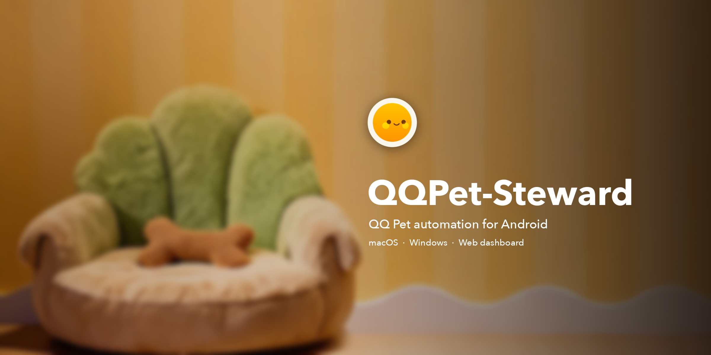
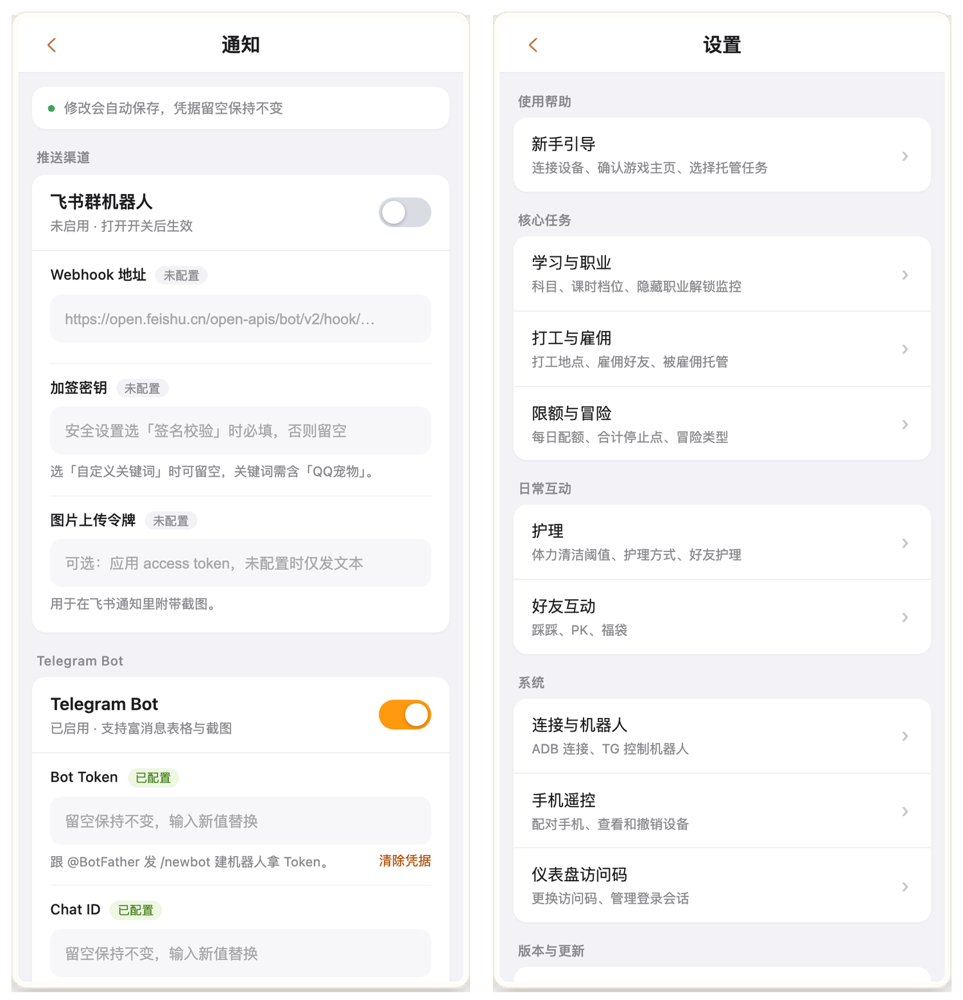

<p align="center">
  
</p>

<h1 align="center">QQPet-Steward</h1>

<p align="center">Automates QQ Pet on an Android phone, with native macOS / Windows apps and a phone-friendly web dashboard.</p>

<p align="center"><a href="README.md">中文</a></p>

<p align="center">
  <a href="https://www.python.org/"></a>
  <a href="https://github.com/openatx/uiautomator2"></a>
  <a href="https://github.com/RapidAI/RapidOCR"></a>
  <a href="https://react.dev/"></a>
  <a href="https://tauri.app/"></a>
  <a href="https://developer.android.com/tools/adb"></a>
  <a href="https://github.com/mps233/QQPet-Steward/blob/main/LICENSE"></a>
  <a href="https://github.com/mps233/QQPet-Steward/releases/latest"></a>
</p>

## Overview

QQPet-Steward plays QQ Pet for you. Connected to an Android phone over adb, it drives the game through uiautomator2 input and reads the screen with RapidOCR: it enrolls in courses, takes jobs, runs adventures, feeds and washes the pet, and visits friends. You set the goals and limits; the scheduler decides what to do next.

It runs on a computer next to the phone. The macOS and Windows builds are native apps with Python, adb, OCR models and a local dashboard bundled, so there is no server URL or separate runtime to install. The same dashboard opens from a phone on the same network: pair once with a QR code, then start or stop the scheduler, edit settings, and follow logs, earnings and a live screenshot. The scenarios, locator registry and OCR layer derive from [qq-pet-copilot](https://github.com/490720818/qq-pet-copilot) (GPL-3.0); this repository adds the native apps, the React dashboard, a task-queue scheduler, notifications and daily reports, and adaptations to newer QQ releases. See [MAC-PORT.md](MAC-PORT.md) for the full list of differences.

## Screenshots

The dashboard in the current build; the interface is Chinese-only.


*Left: Overview — profile card, today's stats, task list and run controls. Right: Adventure log — totals, earnings chart and per-run history.*


*Left: Career tree — attribute values and career routes by tier. Right: Earnings — per-session study and work rewards; names are redacted.*



*Left: Notifications — delivery channels such as Feishu and Telegram. Right: Settings — tasks, care, system and phone remote entries.*

## Features

- **Study and work** — enrolls in school courses and takes jobs at eight locations, with short/long course tiers and 10-minute, 45-minute and 2-hour jobs. Daily study and work hours are tracked against quotas, and each activity stops at its configured limit.
- **Friend hire** — when a friend is configured, work starts by hiring that friend first; the per-friend daily hire cap is tracked locally.
- **Adventure** — runs adventures back to back in the configured type and records every run's rewards; with `adventure.skip_bad_weather` enabled, it recalls the pet when the weather turns bad.
- **Care** — feeds and washes the pet when energy or cleanliness falls below the thresholds; when enabled, friend care runs as part of the same task.
- **Friend interactions** — daily visits, PK with optional target rules, and care visits to specific friends.
- **Employed checks** — during a configured time window, goes out to check whether the pet has been hired and recalls it according to the chosen policy.
- **Gift bags** — scans the pet's own bag and friends' bags, and claims the bags that are ready.
- **Task-queue scheduling** — every task has its own switch, order, interval or daily time window, and failure backoff. Long activities are deferred: the scheduler records the remaining time, returns to the home screen, and runs other work until the activity finishes.
- **Self-healing and reporting** — a failed step re-enters the scene and retries; if it still fails, the scheduler recovers according to `recover.method` (restart the game, or reboot the device/emulator) and retries once more. A main task that still fails sends an alert with a phone screenshot and stops the scheduler; side tasks back off and retry instead.
- **Dashboard and remote control** — a seven-page web dashboard, Telegram control, desktop notifications, Feishu, Telegram and OnePush channels, plus a daily study/work report and an adventure report.

## Installation

### Prerequisites

- **Desktop app:** macOS 26 or later on Apple Silicon, or Windows x64.
- **Phone:** an Android device (or emulator) reachable over adb, with QQ installed, logged in, and the pet feature available.
- **From source:** Python 3.13 and Android platform-tools. Running from source is supported on macOS and Windows; Linux has not been verified.

### Desktop app

**macOS:** download the latest DMG or ZIP from [Releases](https://github.com/mps233/QQPet-Steward/releases/latest). The build is for Apple Silicon and requires macOS 26 or later.

**Windows:** build the x64 setup executable with `desktop/windows/build_native.py`; the current release does not include a Windows installer. The setup installs per user and installs Microsoft WebView2 if it is missing.

The macOS build is ad-hoc signed and not notarized; the Windows build has no Authenticode signature. Both may trigger a system security prompt on first launch. SHA-256 checksums are published with each release.

### From source

```bash
# 0) adb and the phone (skip if adb is already available)
brew install android-platform-tools
adb devices
adb shell settings put global stay_on_while_plugged_in 7

# 1) Python environment
python3.13 -m venv .venv
.venv/bin/pip install -r requirements.txt

# 2) configuration
cp config.example.yaml config.yaml

# 3) dashboard, supervised by launchd (recommended for long runs)
./tools/launchd/install.sh
```

With one device and adb on `PATH`, `adb.path` and `adb.device_serial` can stay empty. The example config ships a bundled Windows path for `adb.path`, so set it to an empty string on macOS. If the phone has a lock-screen password, set `recover.method` to restart the game rather than the device.

On Windows, create the environment with `py -3.13 -m venv .venv` and install with `.venv\Scripts\pip install -r requirements.txt`. Run the scheduler with `.venv\Scripts\python scenarios\runner.py` and the dashboard with `.venv\Scripts\python dashboard.py --port 8787`. There is no launchd; use Task Scheduler for autostart.

### Build the desktop apps

```bash
desktop/macos/scripts/build-macos.sh
```

```powershell
.venv\Scripts\python.exe desktop\windows\build_native.py
```

The macOS app is written to `desktop/macos/target/release/bundle/macos/QQPet-Steward.app`; the Windows installer to `dist/QQPet-Steward_<version>_windows_x64-setup.exe`. Build prerequisites and offline checks are documented in [desktop/macos/README.md](desktop/macos/README.md) and [desktop/windows/README.md](desktop/windows/README.md).

## Usage

1. Open the app, or the dashboard, and complete the four-step onboarding: connect the device, confirm the home screen, choose tasks, finish setup.
2. Press **Start** in the right rail. Only one scheduler can run per machine; a second one exits by itself.
3. To use a phone as a remote, open **Settings → Phone remote** on the computer and scan the one-time QR code. The pairing ticket is valid for five minutes and can be used once; paired devices can be revoked on the same page.
4. For source installs, the dashboard listens on port 8787. The first visit asks for the access code stored in `runs/dashboard_access.token`.
5. To debug the scheduler in a terminal, run `./run.sh` (Ctrl+C stops it). Do not run it at the same time as the dashboard's Start button.

The dashboard has seven pages: Overview, Adventure, Career, Logs, Notifications, Settings and Live. See the Screenshots section above.

Telegram: configure a bot token and the allowed chats under **Settings → TG bot**. The bot answers `/help`, `/status`, `/get`, `/set`, `/attrs`, `/log`, `/run`, `/halt`, `/pause` and `/resume`; messages from chats outside the allowlist are ignored.

## Configuration

Settings can be changed in the dashboard (recommended) or in `config.yaml`. Changes apply on the next scheduling round; adb connection settings and the scheduler engine require a restart. The full field list and defaults are in [config.example.yaml](config.example.yaml).

| Setting | What it controls |
| --- | --- |
| `adb.path` / `adb.device_serial` | adb binary and device serial |
| `control.method` | input method: `injectInputEvent` (default on phones) or `minitouch` (faster on emulators) |
| `school.attribute` / `school.duration` / `school.times_per_day` | course attribute / short or long course tier / daily course limit (0 = unlimited) |
| `work.location` / `work.duration` | job location (eight options) / 10 minutes, 45 minutes or 2 hours |
| `work.hire_name` / `work.hire_wait` / `work.hire_daily_hours` | friend to hire first / wait when busy / daily cap per friend |
| `schedule.study_quota_hours` / `work_quota_hours` | daily study and work quotas |
| `schedule.daily_hour_limit` / `work_stop_hours` / `coin_threshold` | study stop point, combined stop point, coin threshold |
| `adventure.*` / `employed.*` | adventure count, time window and type; employed-check window and recall policy |
| `care.*` / `friend_care.*` | care thresholds and method; friend-care target and interval |
| `tasks.failure_interval` / `recover.method` | retry backoff for failed tasks / recovery method |
| `notify.*` | alert channels and daily reports |

The packaged apps keep configuration and progress in `~/Library/Application Support/QQPetCopilot` on macOS and `%LOCALAPPDATA%\QQPetCopilot` on Windows; set `QQPET_DATA_DIR` to use another directory.

Two game mechanics are worth knowing before changing the defaults:

- **Care medals require manual care.** One-click care does not count toward medal progress. To earn medals, set `care.method` and `friend_care.method` to `ocr检测`, which feeds and washes one step at a time.
- **Study and work have fatigue tiers.** After 8 combined hours the game reduces rewards to 25%; after 12 hours, to 10%. Settings exposes one combined stop point that stops both activities and switches to adventures; the separate study and work stop points can be set in `config.yaml`.

## Project structure

```text
scenarios/   scheduler, task queue and game scenarios
src/         device control, OCR, locators, config, progress, notifications
web/         React dashboard (built to web/dist)
dashboard.py local HTTP server and API
desktop/     macOS and Windows app packaging
tools/       calibration helpers, asset fetchers, launchd installer
tests/       unit tests
```

## Releases and updates

Builds are published on the [Releases page](https://github.com/mps233/QQPet-Steward/releases). The macOS app checks GitHub Releases on its own: an available update downloads on click, stops the scheduler, installs, restarts, and resumes the previous scheduling state. Windows builds are not yet part of the update manifest, so install a new Windows build manually.

## Acknowledgements

- [qq-pet-copilot](https://github.com/490720818/qq-pet-copilot) — the upstream project this repository derives from.
- [uiautomator2](https://github.com/openatx/uiautomator2) — device control and input.
- [RapidOCR](https://github.com/RapidAI/RapidOCR) and [PP-OCRv6](https://github.com/PaddlePaddle/PaddleOCR) — text recognition.
- [minitouch](https://github.com/DeviceFarmer/minitouch) — touch injection.
- [qqpet-module-opener](https://github.com/yikehuang/qqpet-module-opener) — the approach for opening the pet page in emulators.

## Disclaimer

This project is for learning and research in automation and OCR. Automated play may violate the game's terms of service; any consequences are the user's responsibility. QQ Pet and its game assets belong to Tencent; this project is not affiliated with Tencent.

## License

GNU General Public License v3.0. See [LICENSE](LICENSE).
