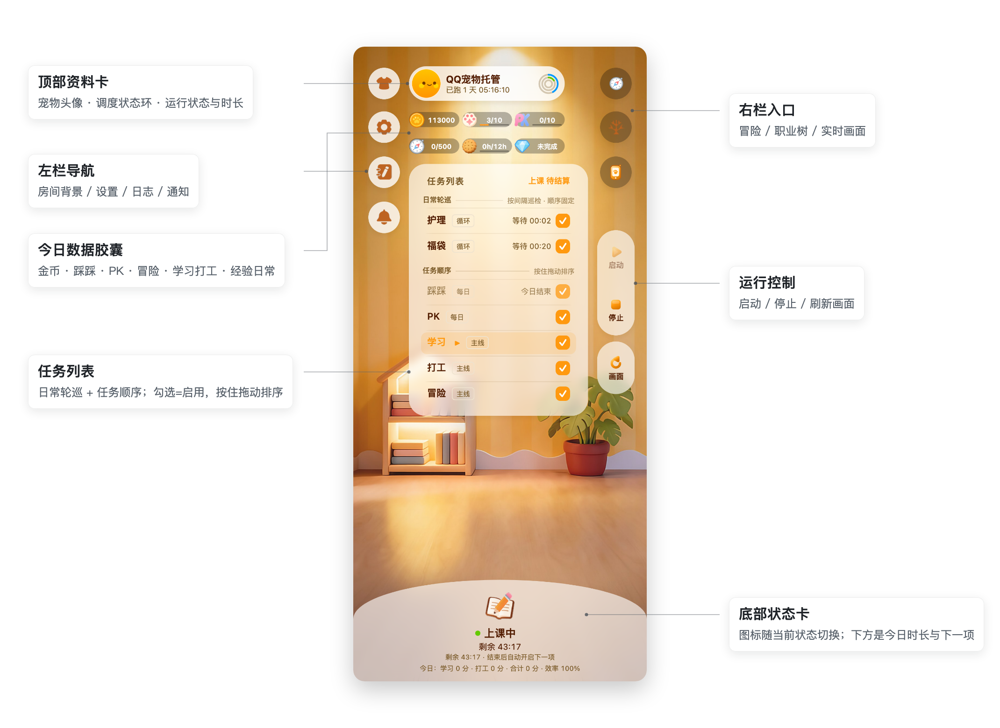

# QQ宠物托管（QQPet-Steward）

用电脑挂着 Android 手机，让 QQ 宠物自己上课、打工、冒险、被好友雇佣。
**手机浏览器打开就能看、能改、能接手操作**——不用装桌面 GUI，也不用守在电脑前。

核心是 Python + adb + uiautomator2 + RapidOCR。项目源自
[490720818/qq-pet-copilot](https://github.com/490720818/qq-pet-copilot)（GPL-3.0）：
本版在它的基础上做了 **macOS 适配**，以 React 仪表盘统一 macOS 本机 App 与手机浏览器界面；
与上游的差异见 [MAC-PORT.md](MAC-PORT.md)。

> 调度器与仪表盘主要在 macOS 上验证，Windows / Linux 未实测。

## 客户端与运行方式

- **Android / 手机 PWA**：现有 React 仪表盘，作为**遥控端**连接 Windows / macOS 上的托管服务；手机不跑 OCR、ADB 或 Python。
- **同源浏览器**：直接打开 `http://<电脑IP>:8787/` 仍用访问码 + Cookie；根页面壳公开以便远程客户端进入配对门禁，所有数据/文件 API 仍然鉴权。
- **macOS `.app`**：`desktop/macos/` 的完整本机应用，包含 UI、Python、仪表盘后台和调度器；打开后自动启动本机后台并进入界面，无需填写 URL 或另装 Python。App 自动通过 launchd 托管后台，已有源码托管实例会继续被采用；关闭窗口或退出 App 不会主动停止任务。
- **Windows 便携版**：`desktop/windows/` 的 onedir 打包脚手架，仪表盘与调度器是两个 exe；安装器、开机自启属于下一阶段。

手机首次连接点「打开连接设置」或「扫码配对」：电脑在「设置 → 手机遥控」生成一次性二维码/链接。配对使用一次性票据换取设备 Bearer Token，
票据 5 分钟有效且只能用一次；设备可在同一页撤销。Cookie 仍用于同源浏览器，不会跨域复用。

构建完整 macOS App：

```bash
desktop/macos/scripts/build-macos.sh
```

产物在 `desktop/macos/target/release/bundle/macos/QQ Pet Dashboard.app`。
构建条件、随包资源和离线校验见 [macOS 说明](desktop/macos/README.md)。

构建 Windows portable（在 Windows 上执行）：

```powershell
.venv\Scripts\python.exe desktop\windows\build_portable.py
```

`src.runtime_process` 在源码模式选择 `.venv/bin/python` / `.venv\Scripts\python.exe`；
macOS 冻结版执行随包 `QQPetRuntime scheduler`，Windows 冻结版维持同级 scheduler exe。
Windows 停止进程使用 `CTRL_BREAK_EVENT → taskkill /T → /F`，POSIX 保持
`SIGINT → SIGTERM → SIGKILL`。Windows 打包与真实进程行为仍需在 Windows 实机验证。

macOS 打包版默认把配置和进度放在 `~/Library/Application Support/QQPetCopilot/`，
可通过 `QQPET_DATA_DIR` 指定数据根；采用已有后台时沿用它的数据。App 的只读运行资源与用户数据分开，
移动 App 不需要移动源码。源码运行及原有 `tools/launchd/install.sh` 托管方式继续有效。



## 它能做什么

- **学习 / 打工**：自动进学园选课上课、去小镇打工，按你设定的时长目标推进，到量自动停（转冒险）。
- **冒险**：到点连跑，遇到"天色不对"自动召回，收益曲线在仪表盘上能看。
- **好友互动**：踩踩、PK、去指定好友家护理、雇佣好友打工；PK 支持只打比自己低的、指定打手名单。
- **被雇佣召回**：定时代你出门看有没有被雇佣，按策略召回（或故意不召回，把收益让给雇主）。
- **照顾宠物**：体力/清洁低于阈值自动喂食、洗澡；也支持一键护理。
- **福袋**：自动逛好友家领系绳福袋。
- **出问题自己救**：页面错乱先回主页重进，仍失败就重启游戏/重启模拟器再回宠物页；
  连续失败发通知（桌面通知 + Bark/飞书/Telegram 等）并附手机截图。

任务顺序、开关、时间窗、每日次数都在仪表盘上改，保存后下一轮调度生效；
只有 adb 连接与调度引擎需要重启调度器。

## 快速开始

**macOS 完整 App**：打开 App 后自动准备本机后台；Python、ADB 和后台已随包提供，
无需填写服务器地址。可在设置中选择设备、调整任务，然后在首页点击「启动」。

以下是仍然有效的**源码运行方式**。需要 **Python 3.13**、**adb（Android platform-tools）** 和一台 **Android 真机**
（USB 调试打开、QQ 已登录宠物、充电时不熄屏）。

```bash
# 0) 准备 adb 和手机
brew install android-platform-tools        # 已有 adb 可跳过
adb devices                                # 确认手机已授权、只显示一台 device
adb shell settings put global stay_on_while_plugged_in 7   # 插着电不熄屏

# 1) 装依赖
python3.13 -m venv .venv
.venv/bin/pip install -r requirements.txt

# 2) 配置
cp config.example.yaml config.yaml
#   单台设备 + adb 在 PATH 时，adb.path / adb.device_serial 都可以留空（自动探测）。
#   config.example.yaml 里的 adb.path 默认是 Windows 的随包路径，macOS 上建议改成空字符串。
#   多台在线设备时再填 adb.device_serial（adb devices 查看）。
#   真机设了锁屏密码的话，recover.method 用「重启游戏」，别用「重启设备」。

# 3) 起仪表盘（macOS 推荐：launchd 托管，崩溃自愈、长跑安全）
./tools/launchd/install.sh
#   之前用 ./dashboard.sh 起过临时实例的话，先停掉再装，否则 8787 被占：
#   kill $(lsof -nP -iTCP:8787 -sTCP:LISTEN -t)
```

手机和电脑连同一个 Wi-Fi，浏览器打开 **`http://<电脑的局域网 IP>:8787`**，
可以「添加到主屏幕」当 App 用。首次访问输入 `runs/dashboard_access.token` 里的访问码
（可在「设置 → 仪表盘访问码」里改），登录后点右栏的「启动」拉起调度器。

只在终端里调试调度器时才用 `./run.sh`（Ctrl+C 停止）。它和仪表盘的「启动」
**二选一**，不要同时开。**别用 `nohup ./run.sh &` 长跑**：`nohup`/`setsid`
不改变 macOS 的 application coalition，强制退出终端 App 仍可能把它一起杀掉；
长跑用上面的仪表盘「启动」。

Windows（未实测）：`run.sh` 写死了 `.venv/bin/python`，Windows 下请直接用
`.venv\Scripts\python scenarios\runner.py`；仪表盘用
`.venv\Scripts\python dashboard.py --port 8787`，再从界面点「启动」。
Windows 没有 launchd，开机自启用「任务计划程序」。

macOS 与 Windows 在 adb 探测、模拟器探测、桌面通知上的差异见
[MAC-PORT.md](MAC-PORT.md)。

## 手机仪表盘

源码仪表盘默认端口 8787、绑定 `0.0.0.0`；macOS 完整 App 的随包后台默认只绑定
`127.0.0.1`，自动供本机界面使用。需要局域网手机遥控时可继续使用源码 launchd 托管方式。
日志 3 秒、数据 6 秒、实时画面 15 秒自动刷新。

**界面不限于手机**：同一局域网里任何设备打开 `http://<跑仪表盘那台机器的 IP>:8787`
都是同一个界面（平板、另一台电脑都行）。注意这是「一台跑、多台看」——调度器与手机
只能连在一台机器上，两台机器同时跑会抢设备（内置单实例守卫，后启动的会自己退出）。

首次访问需要输入 `runs/dashboard_access.token` 中的访问码（文件权限 0600）。
**嫌随机码难记就在「设置 → 仪表盘访问码」里改成自己好记的口令**（至少 8 位；改完当前
浏览器自动换新会话，其它已登录设备需要重新验证）。登录失败按来源 IP 限流
（5 分钟内 8 次）。验证后通过 HttpOnly、SameSite Cookie 记住会话；脚本可用
`Authorization: Bearer <访问码>`。通知凭据是只写字段，接口只返回“是否已配置”。

> ⚠️ HTTP 访问码仍可能被同网段监听：**不要做公网端口映射**。
> 远程访问请走 Tailscale 等私有网络或 HTTPS；删除访问码文件（连同 `runs/dashboard_access.custom`）
> 并重启仪表盘可以重新生成随机码、撤销全部旧会话。

面板分七页：**总览 / 冒险 / 职业 / 日志（实时日志·收益记录）/ 通知 / 设置 / 实时画面**。

| 位置 | 元素 | 作用 |
| --- | --- | --- |
| 顶部 | 宠物资料卡 + 状态环 | 环色 = 调度器状态；点环展开体力/清洁/心情三行 |
| 顶部 | 今日数据胶囊 | 金币 / 踩踩 / PK / 冒险 / 学习打工时长 / 经验日常，带进度条的有每日上限 |
| 中部 | **任务列表** | 分两组：**日常轮巡**（护理·福袋，顺序固定）与**任务顺序**（踩踩/PK/学习/打工/冒险，**按住拖动排序**）；勾选框即启用，拖动后同时写任务顺序与主任务优先级 |
| 右栏 | 冒险 / 职业 / 实时画面 | 收益曲线、职业解锁计划、手机实时画面 |
| 右栏 | 启动 / 停止 | 启停调度器（停止先让当前任务收尾，12 秒未退再强制结束） |
| 底部 | 状态图标 + 今日统计 | 图标跟着"正在做的事"换；下面是今日时长与效率档 |

底部状态图标全部取自游戏内素材，跟官方一致：上课=书本铅笔、打工=爪印金币、
冒险=指南针、护理=香皂、踩踩=爪印、PK=PK 字样、等待中=地球。

> 手动选择房间背景后，会暂停"按当前任务自动换背景"；点一下左上角的衣服圆钮可以
> 按任务跟回，长按则切下一张。

Telegram：在「设置 → TG 机器人」里配好后，除了收通知还能反向控制——`/status`、`/get`、
`/set 字段 值`、`/log`、`/run`、`/halt`、`/pause`、`/resume`，只认 `tgbot.allowed_chats`
白名单里的会话。

## 实时画面

「实时画面」页每 15 秒自动截一张手机屏幕（切到后台会暂停，回来时立即补一张），
点「刷新画面」可以马上重拍；点画面或「在新标签打开原图」能看全尺寸截图。

截图走与调度器相同的 adb 连接，不需要额外组件；手机不在线或截图失败时会保留上一张，
并在页面下方显示原因。

## 推荐配置

在「设置 → 学习/打工 配额」和「合计停止点与收益档」里按玩法调。配额决定今天各做多少，
合计停止点决定学习+打工加起来到多少后两项一起停（配额先到会先切另一项）。

| 玩法 | 建议 |
| --- | --- |
| 战力型 | 学习配额拉高、打工配额 0；合计停止点设成你愿意投入的总时长（0 = 不限） |
| 均衡型 | 学习和打工各分几小时，合计停止点按你能接受的疲劳档设 |
| 职业型 | 打工配额占大头，职业卡住再转学习 |
| 勋章型 | 没有通用配置，按勋章要求来 |

## 两个容易踩的游戏机制

**护理勋章不能一键。** 一键护理不计入勋章进度。要拿勋章，必须把护理方式改成
**「ocr检测」**（手动喂食/洗澡）：`care.method` 和 `friend_care.method`。

**收益有疲劳档。** 学习+打工合计超过 8 小时后收益降到 25%，超过 12 小时降到 10%。
设置页有三个停止点：「合计满则停止」= 两项一起停、转冒险；「停学习点」和「停打工点」
可以分开设。比如停学习点 8、停打工点 12，就是学满 8h 后继续打工到 12h。

## 常用配置

改 `config.yaml` 或在仪表盘设置页改（推荐后者，保存后下一轮调度生效）。
完整字段与默认值见 [config.example.yaml](config.example.yaml)。

| 配置 | 说明 |
| --- | --- |
| `adb.path` / `adb.device_serial` | adb 路径 / 设备序列号（设置页下拉带机型标注，离线模拟器也会列出） |
| `control.method` | 控制方案：`injectInputEvent`（真机默认）/ `minitouch`（模拟器更快） |
| `school.attribute` / `school.duration` / `school.times_per_day` | 学哪门课 / 课时档位（短课/长课，实际分钟数选课后读取）/ 每天学习次数上限（0 不限） |
| `work.location` / `work.duration` | 打工地点（8 个可选）/ 时长（10 分钟 / 45 分钟 / 2 小时） |
| `work.hire_name` / `work.hire_wait` / `work.hire_daily_hours` | 优先雇的好友 / 他忙时是否等 / 每人每天最多被雇几小时 |
| `schedule.study_quota_hours` / `work_quota_hours` / `daily_hour_limit` / `work_stop_hours` / `coin_threshold` | 今日学习/打工配额、合计停止点与金币阈值（见上两节） |
| `adventure.*` / `employed.*` | 冒险次数/时间/类型；被雇佣检查时间段与召回策略 |
| `care.*` / `friend_care.*` | 护理阈值、护理方式、好友护理对象与间隔 |
| `tasks.failure_interval` / `recover.method` | 统一失败重试间隔 / 异常恢复方式 |
| `notify.*` / `notify.quota_done` | 告警渠道、日内收益汇总（内容见 [docs/NOTIFICATIONS.md](docs/NOTIFICATIONS.md)） |

## 收益通知

学习+打工当天都跑完时推「打工学习日报」，逐次列出每节课、每次打工的收益；
每天 23:59 推「冒险日报」，给总次数/金币/心情/清洁/体力/命中率/平均每次的指标表。
Telegram 用原生表格，飞书/桌面/OnePush 自动转纯文本；完整示例与字段说明见
[docs/NOTIFICATIONS.md](docs/NOTIFICATIONS.md)。

## 自检与排查

```bash
./run.sh --test coins               # 只测主页金币识别
./run.sh --test care.read_status    # 只测体力/清洁识别
./run.sh --test work.select_place   # 只跑某个阶段
```

游戏更新后如果某个按钮点不到了，通常是界面文案变了（比如冒险的「开始」改成「出发」）。
用 `./run.sh --test <模块>` 单测逐屏校准 `src/locators.py` 即可，不需要重新做模板。

## 与上游的关系

调度器、各场景实现、UI 定位注册表、OCR 封装等核心能力来自
[上游项目](https://github.com/490720818/qq-pet-copilot)（Windows 桌面版）。
本版做了 macOS 运行链路适配、浏览器仪表盘、实时画面截图，以及一批新版 QQ 界面适配；
差异清单见 [MAC-PORT.md](MAC-PORT.md)。

上游的 PyQt6 桌面 GUI（`main.py`）、旧打包脚本与 Windows 打包 CI
（`release.yml`）已从本仓库移除；当前支持源码运行与浏览器界面，并在 `desktop/` 提供
完整 macOS App 和 Windows portable 打包入口。
要用上游桌面版（含打包 exe 说明），见
[上游 README](https://github.com/490720818/qq-pet-copilot)。

## 致谢

[qq-pet-copilot](https://github.com/490720818/qq-pet-copilot)（上游）、
[uiautomator2](https://github.com/openatx/uiautomator2)（控件与点击）、
[RapidOCR](https://github.com/RapidAI/RapidOCR) / [PP-OCRv6](https://github.com/PaddlePaddle/PaddleOCR)（文字识别）、
[minitouch](https://github.com/DeviceFarmer/minitouch)（触摸注入）、
[PyQt-Fluent-Widgets](https://github.com/zhiyiYo/PyQt-Fluent-Widgets)（上游 GUI）、
[qqpet-module-opener](https://github.com/yikehuang/qqpet-module-opener)（模拟器打开宠物页的思路）。

## 免责声明

本项目仅供学习研究自动化与 OCR 技术使用。自动化操作可能违反游戏服务条款，
由此产生的一切后果由使用者自行承担。

## 许可证

GNU General Public License v3.0 (GPLv3)，详见 [LICENSE](LICENSE)。
